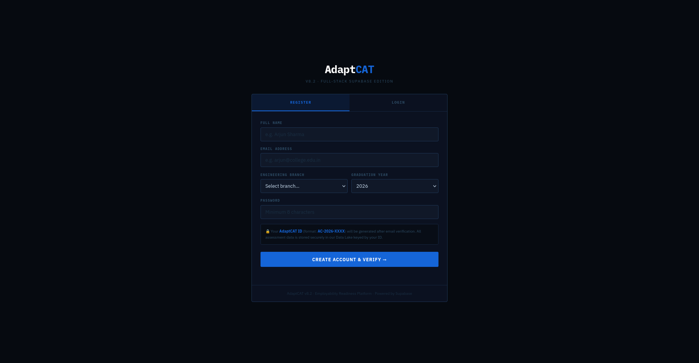
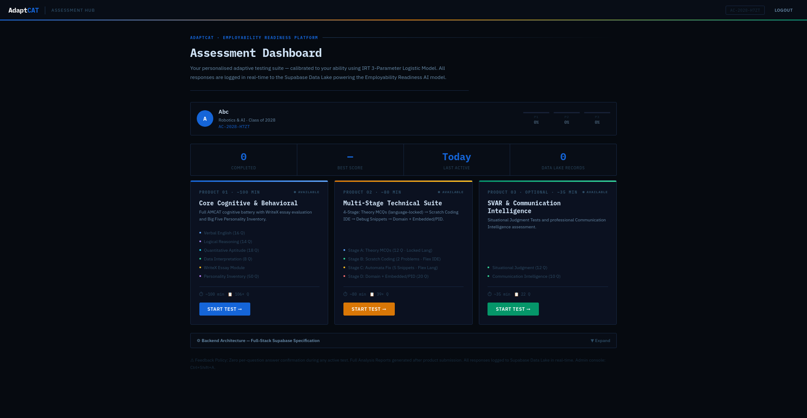
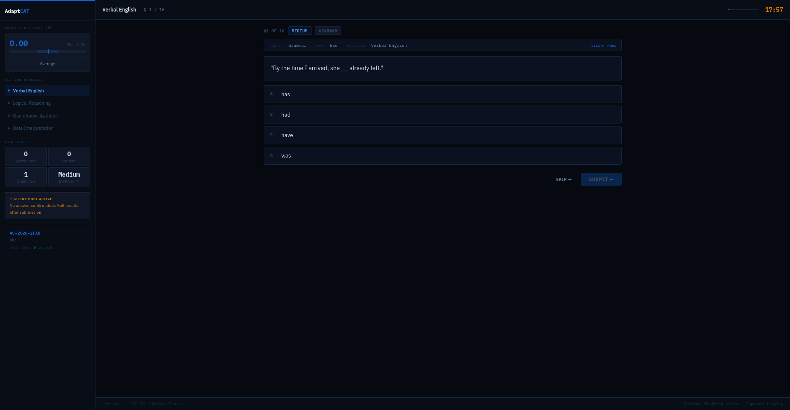
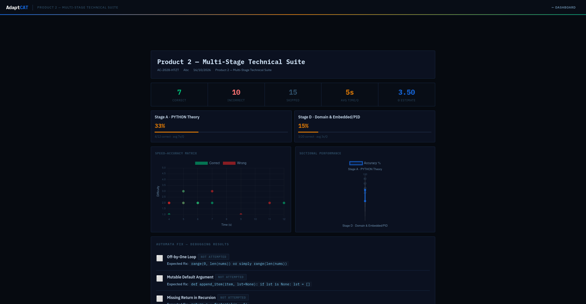
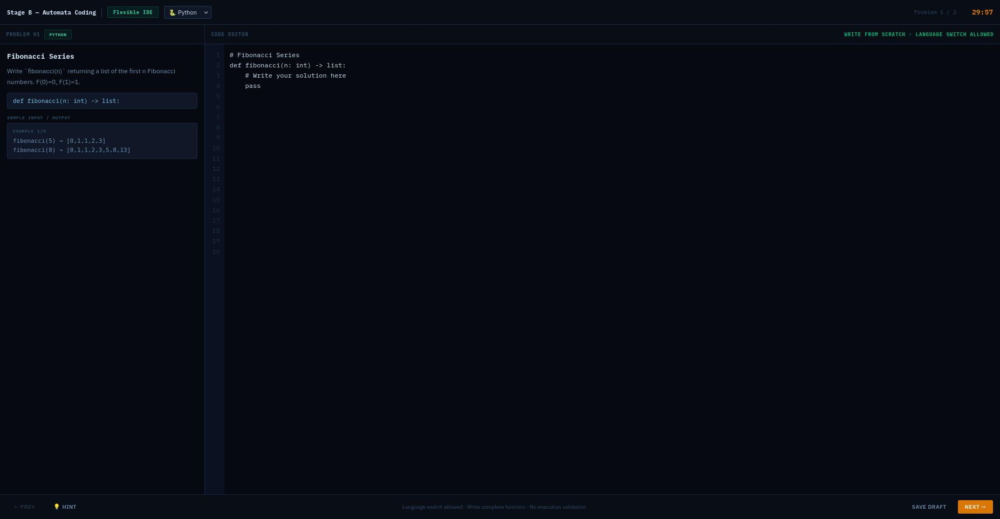

# AdaptCAT

A single-file, browser-based adaptive assessment platform prototype, structured like public AMCAT-style tests (aptitude, behavioral, technical). It is an independent learning project and is **not affiliated with AMCAT, Aspiring Minds or SHL**.

> **Status: prototype.** The application is contained in one HTML file, but it loads fonts, Chart.js, and the Supabase client from CDNs. Item parameters are hand-set, not calibrated from real test data, and the optional backend and admin console are demo-grade (see [Limitations](#limitations)).

## Run it

Open `adaptcat_v8_2.html` in a browser. No application server is needed for the demo, but an internet connection is required for its CDN-hosted dependencies.

Optional backend: run `adaptcat_v8_2_schema.sql` in a Supabase project, then set `SUPABASE_URL` and `SUPABASE_ANON` near the top of the script. Without them the app logs to local memory only.

Before sharing a configured copy, replace `CHANGE_ME_BEFORE_USE`. This does not make the client-side admin console secure; production authentication and authorization must be implemented on a server.

## Documentation

The [architecture design document](docs/architecture.html) describes a proposed target architecture. Not every component or figure in that document is implemented; this README is the source of truth for the current prototype.

## Products

| Product | Contents |
|---|---|
| 1. Core Cognitive and Behavioral | English, Logical, Quantitative, Data Interpretation, WriteX essay editor with live analysis, Big Five personality inventory |
| 2. Technical and Domain | Stage A theory MCQs (language locked) → Stage B code-from-scratch IDE → Stage C debug-the-snippet (languages switchable in B and C) → Stage D branch technical (8051/Arduino/ESP32, PID) |
| 3. SVAR and Communication | Situational judgment and communication scenarios |

Each product is standalone and is launched from a dashboard. There is no per-question feedback during a test. Reports include sectional accuracy and visual summaries where applicable; Product 1 also includes WriteX and personality analysis.

## What is implemented and what is not

| Feature | Status |
|---|---|
| 3PL response model P(θ) and θ update | Working through `IRT.P`, `IRT.info`, and `IRT.update`; `submitAnswer()` applies the update |
| Adaptive item selection | Working through `IRT.selectNext()` and `loadNextQuestion()`, but it picks the item whose difficulty `b` is closest to θ. It is **not** Maximum Fisher Information |
| Item bank (306 assessment items, plus 5 WriteX prompts) | Defined in the `BANK_*`, `CODE_SNIPPETS`, and `PERS_Q` collections. For adaptive MCQ banks passed through `enrich()`, missing parameters default to `a = 1.0 + diff*0.2`, `b = (diff-2)*1.2`, and `c = 0.20`; they are not calibrated |
| AdaptCAT ID registration (`AC-YYYY-XXXX`) | Working through `genAdaptCATId()`, `doRegister()`, and `doVerifyOTP()` |
| Local data-lake logging | Working in memory for the current session through `logToDataLake()` and `updateDataLakeUI()` |
| Supabase logging and profiles | Partial: `getSB()`, `doRegister()`, `doLogin()`, and `logToDataLake()` activate it only when real credentials are configured |
| Admin console (hidden entry, TOTP, lockout, session expiry) | Working client-side through `openAdminConsole()`, `adminUnlock()`, `generateAdminTOTP()`, and `adminSessionValid()`; it is not real security |
| 500-response calibration monitor | `renderIRTTable()` implements a status table at the threshold; no calibration function is implemented |
| EAP scoring, shadow testing, Sympson-Hetter exposure control | **Not implemented**; `IRT.update()` and `IRT.selectNext()` implement different methods |

## Limitations

- Item parameters are assumptions, so θ estimates reflect the model, not real psychometric calibration.
- Row Level Security is enabled in the schema, but the policies use `USING (true)` and do not restrict rows.
- OTP generation uses `Math.random()` and is shown on screen (dev mode); passwords use unsalted SHA-256. Do not use this for real users.
- The admin secret and TOTP run in client-side JavaScript, so anyone with the page source can bypass them.
- Tested only by the author; no external users yet.
- The Stage B coding editor captures code but, as shown in the demo, does not execute or validate it.
- The Product 3 report screenshot shows an `undefined` section label; report grouping for that product still needs correction.
- No automated test suite or cross-browser compatibility record is included.

## Roadmap

1. Switch selection to Maximum Fisher Information with a randomesque top-k for exposure control.
2. Add EAP scoring with Gaussian quadrature.
3. Calibrate `a`/`b` from collected responses (500-response threshold per item).
4. Move auth and admin to a server, and replace the permissive RLS policies.

## Version history

| Version | Added |
|---|---|
| v3 | `archive/adaptcat_v3.html`: separate logical and technical test paths with adaptive question selection, coding, WriteX, and personality sections |
| v4 | No file included; per development notes |
| v5 | No file included; per development notes |
| v6 | No file included; per development notes |
| v7 | `archive/adaptcat_v7.html`: three dashboard products covering cognitive and behavioral, technical and domain, and SVAR and communication sections |
| v8 | No file included; per development notes |
| v8.2 | `adaptcat_v8_2.html`: Supabase schema integration and logging, register/login/OTP, client-side admin console, four-stage technical product, and calibration status monitor |

The `archive/` folder holds earlier versions kept for reference; they were not updated for the security notes.

Published on: 2026-10-16.

## How this was built

I specified the requirements and iterated on each version; the code was generated with AI assistance and I review and test it.

## License

No license has been selected for this repository. Public visibility does not grant permission to reuse, modify, or redistribute the code.

## Screenshots

Screenshots are from a local test run with a dummy account. Some on-screen text (for example "Supabase Data Lake" and "Employability Readiness AI model") describes the intended full-stack design. In this offline build, responses are logged in memory only and no such model exists.

| Register | Dashboard |
|---|---|
|  |  |

| Product 1 question | Report |
|---|---|
|  |  |

| Product 2 IDE |
|---|
|  |
